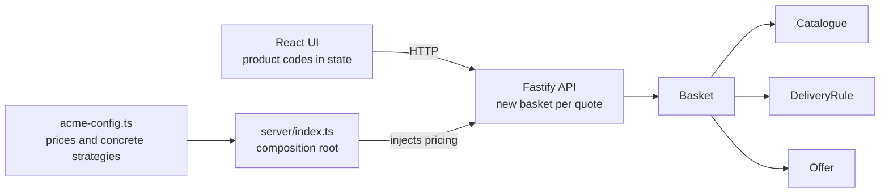

# Acme Widget Basket

A small basket-pricing app with a TypeScript domain, a stateless Fastify API, and a React UI. The server calculates every price; the browser keeps only product codes.

## Quick start

```sh
docker compose up --build
```

Open http://localhost:3000. One container serves both the UI and API. Stop it with `docker compose down`.

For local development, use Node 24 (`nvm use` if you use nvm):

```sh
npm ci
npm run build
npm start
```

For UI hot reload, leave that server running and run `npm run dev` in another terminal. Open http://localhost:5173; Vite proxies `/api` to port 3000. After domain or server changes, rebuild and restart the server.

### Tests

```sh
npm ci
npm run check
npx playwright install chromium
npm run test:e2e
```

Playwright builds the project, starts a fresh server on port 3100, runs the Chromium flow, and stops its server afterward. The Docker app can stay running on port 3000.

`check` runs both TypeScript configurations, Biome, and the domain and API tests. Domain tests cover the four brief examples, discount rounding and repetition, delivery boundaries, catalogue validation, empty and unknown baskets, and injected strategies. API tests use Fastify's `inject()` without opening a port. The browser flow adds two red widgets, checks the discount and $54.37 total, removes one to reach $37.90, then clears the basket.

## How it works



This is one package and one container. `src/domain` has no HTTP, React, browser, or Node imports. The web adapter imports only domain types, which disappear from the browser build. `src/server/index.ts` wires the Acme configuration into the HTTP adapter and starts it.

Every `Basket.quote()` derives a fresh result in six steps:

1. Sum item prices into the undiscounted subtotal.
2. Apply each offer and discard results that are `null`.
3. Subtract the combined discounts, with a floor of zero.
4. Calculate delivery on that discounted subtotal, or charge zero for an empty basket.
5. Add delivery to get the total.
6. Group items by code into quote lines, preserving first-added order.

### HTTP contract

| Route | Input | Success |
| --- | --- | --- |
| `GET /api/products` | None | `{ "products": Product[] }` |
| `POST /api/quote` | `{ "items": string[] }` | `Quote`: lines, subtotal, discounts, delivery, total |

All monetary values in both responses are integer cents. Each quote request builds its own basket. The API strictly rejects malformed bodies, non-string items, and extra body properties with Fastify's default HTTP 400 response. Unknown codes return HTTP 400 with `{ "error": "UNKNOWN_PRODUCT", "message": "Unknown product code: …" }`.

```sh
curl http://localhost:3000/api/quote \
  -H 'Content-Type: application/json' \
  -d '{"items":["R01","R01"]}'
```

The response contains `subtotal: 6590`, a discount of `1648`, `delivery: 495`, and `total: 5437`.

## Pricing rules and assumptions

| Product | Code | Price |
| --- | --- | ---: |
| Red Widget | R01 | $32.95 |
| Green Widget | G01 | $24.95 |
| Blue Widget | B01 | $7.95 |

1. Money is integer cents throughout the domain and API. Only the UI's `formatMoney` converts cents to dollars for display.
2. Every second red widget receives 50% off. The offer repeats per pair: two or three reds get one discount; four reds get two.
3. Fractional-cent discounts round up in the customer's favour, per discounted item. Half of $32.95 is $16.475, so the discount is $16.48. Rounding down would make the two-red example $54.38 instead of $54.37.
4. Delivery uses the subtotal **after discounts**. The two-red basket falls from $65.90 to $49.42 and receives the $4.95 delivery tier. Charging delivery before discounts would give $52.37, contradicting the example.
5. Delivery thresholds include their lower bound: under $50.00 costs $4.95; $50.00–$89.99 costs $2.95; $90.00 or more is free.
6. An empty basket totals $0.00 with no delivery charge.
7. Unknown product codes throw `UnknownProductError` and leave a domain basket unchanged. The HTTP adapter rejects the entire request.
8. Offers are independent and stack additively. There is no priority or exclusivity; the discounted subtotal cannot go below zero.
9. The app uses USD only, without tax.
10. The server owns pricing. The client submits only product codes and displays the returned quote, retaining previous numbers while an update is pending. Aborting obsolete requests prevents stale responses from replacing the latest quote; failures appear inline.

The four brief examples are tested directly:

| Basket | Subtotal | Discount | Delivery | Total |
| --- | ---: | ---: | ---: | ---: |
| B01, G01 | $32.90 | $0.00 | $4.95 | **$37.85** |
| R01, R01 | $65.90 | $16.48 | $4.95 | **$54.37** |
| R01, G01 | $57.90 | $0.00 | $2.95 | **$60.85** |
| B01, B01, R01, R01, R01 | $114.75 | $16.48 | Free | **$98.27** |

## Design decisions

Integer cents make the rounding rule explicit and keep pricing free of floating-point dollar arithmetic. Catalogue construction rejects duplicate codes and invalid prices; delivery construction validates its thresholds and keeps a sorted copy. Configuration inputs are copied so later caller mutations cannot change shared prices or rules.

`DeliveryRule` and `Offer` are small strategy interfaces. `Basket` receives its catalogue, delivery rule, and offers through its constructor, so different policies can be substituted without changing the basket. Tests inject plain object strategies to prove that dependency boundary. Acme's prices and strategies live in `src/domain/acme-config.ts`.

The API is stateless because the browser already holds the basket. Sharing a single server-side basket would mix different users' items. Sending the complete code list makes removing an item a browser state change, with no removal endpoint or storage needed.

One package, plain `tsc`, and Vite keep the build straightforward. TypeScript compiles the domain and server to `dist/domain` and `dist/server`; its server configuration excludes the DOM library. Vite builds into `dist/web` without deleting the server output. Fastify serves those assets from the same origin as the API, and Vite uses a development proxy, so no CORS layer is needed. The production image runs as the non-root `node` user, with only runtime dependencies.

## Adding an offer

1. Add a class in `src/domain` implementing `Offer`, with tests for its business rules.
2. Import and append an instance to `offers` in `acme-config.ts`. `Basket`, the API, and the UI need no changes.

For example, this hypothetical “three Blue Widgets for the price of two” strategy would discount one blue widget per group of three. It is a sketch only and is **not an active offer**:

```ts
import type { Product } from "./catalogue.js";
import type { AppliedDiscount, Offer } from "./offer.js";

export class ThreeForTwo implements Offer {
  constructor(
    private readonly options: { readonly productCode: string; readonly description: string },
  ) {}

  apply(items: readonly Product[]): AppliedDiscount | null {
    const matching = items.filter((item) => item.code === this.options.productCode);
    const product = matching[0];
    const freeItems = Math.floor(matching.length / 3);
    if (!product || freeItems === 0) return null;
    return {
      description: this.options.description,
      amount: freeItems * product.price,
    };
  }
}
```

Configure it with `new ThreeForTwo({ productCode: "B01", description: "Blue Widget: 3 for 2" })` when adding it to `offers`.

Delivery can be extended the same way: implement `DeliveryRule` and inject it through the pricing configuration.

## Trade-offs and next steps

Basket state lasts only for the current page visit. The app deliberately has no persistence, sessions, authentication, payments, tax, multiple currencies, admin rules UI, dark mode, health endpoints, or CI workflow.

If the product grows, useful next steps are persisted baskets, data-driven pricing configuration, explicit offer priority and exclusivity, and CI that runs the existing checks. These should follow concrete requirements; the current three-product domain does not need them.

## Project layout

```text
acme-basket/
├── src/
│   ├── domain/
│   │   ├── money.ts
│   │   ├── catalogue.ts
│   │   ├── delivery-rule.ts
│   │   ├── tiered-delivery.ts
│   │   ├── offer.ts
│   │   ├── second-item-percentage-discount.ts
│   │   ├── basket.ts
│   │   ├── acme-config.ts
│   │   └── *.test.ts
│   ├── server/
│   │   ├── app.ts
│   │   ├── app.test.ts
│   │   └── index.ts
│   └── web/
│       ├── main.tsx
│       ├── App.tsx
│       ├── api.ts
│       ├── format.ts
│       ├── ProductCard.tsx
│       ├── BasketSummary.tsx
│       ├── QuoteLines.tsx
│       ├── PriceBreakdown.tsx
│       └── styles.css
├── e2e/basket.spec.ts
├── index.html
├── package.json / package-lock.json
├── tsconfig.json / tsconfig.server.json
├── vite.config.ts / playwright.config.ts / biome.json
├── Dockerfile / compose.yaml / .dockerignore
├── .gitignore / .nvmrc / .npmrc
└── README.md
```
